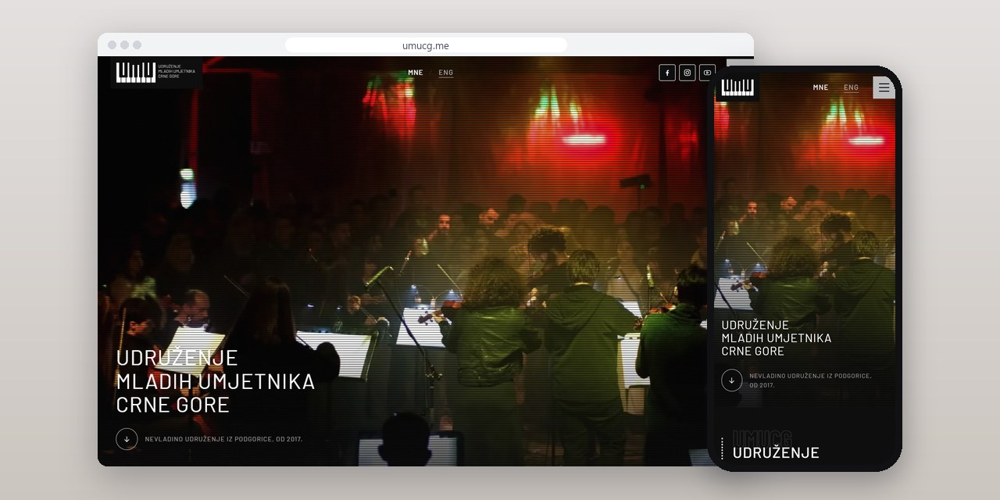
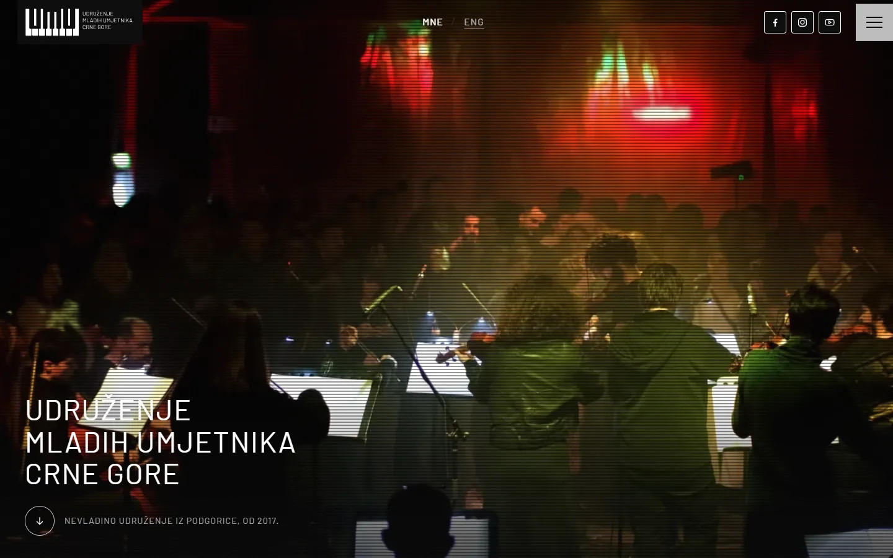
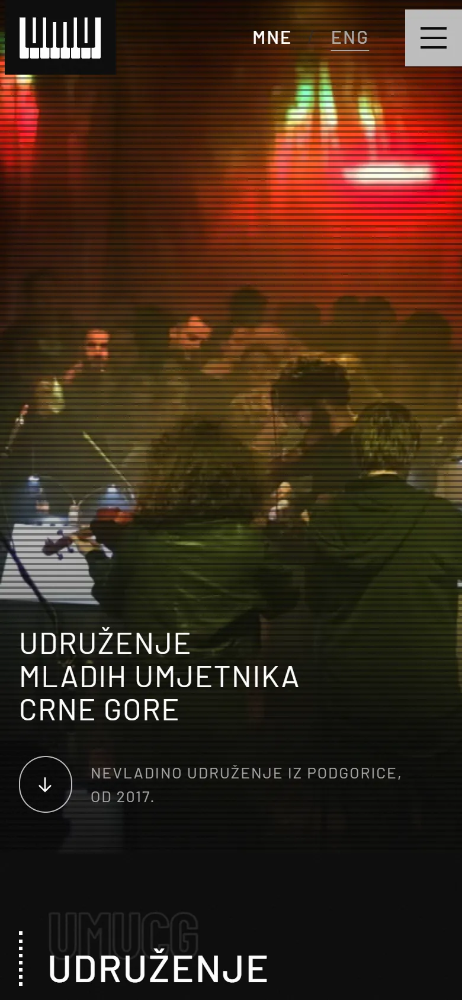
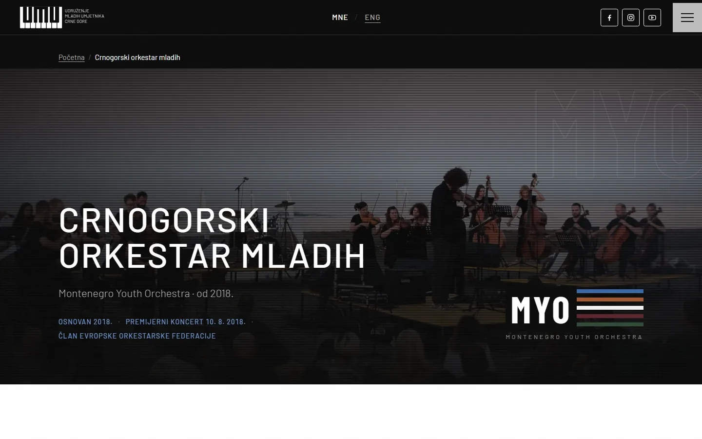
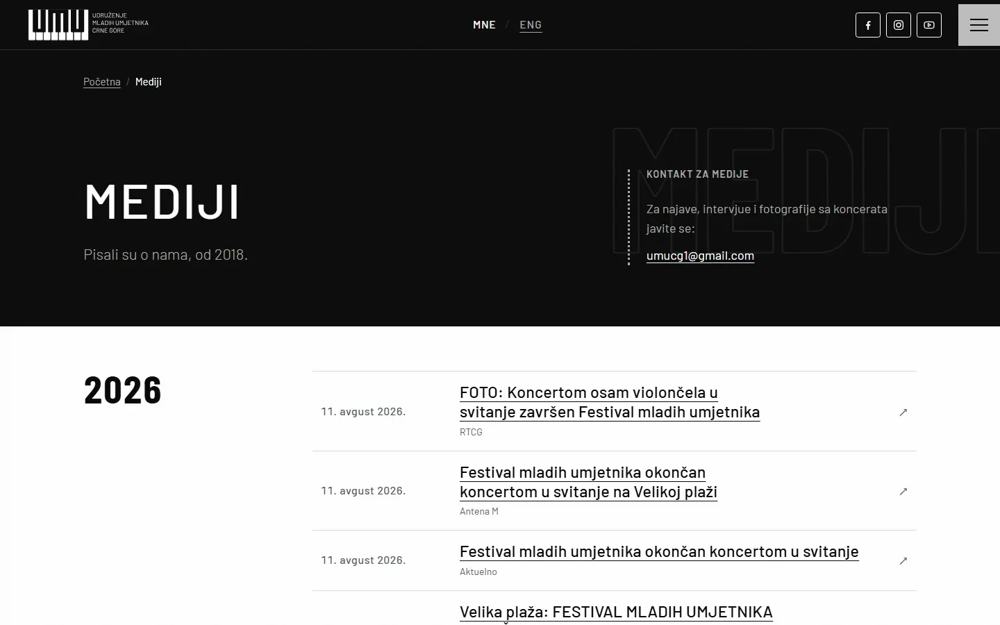

# UMUCG

A bilingual site for an association of young artists from Podgorica and its youth orchestra, with a concert chronicle since 2018 and 112 press articles.

**[umucg.me](https://umucg.me/)** · [Case study](https://svilenkovic.com/portfolio/umucg) · [Srpski](README.sr.md)

> [!NOTE]
> Client project. The source code belongs to the client and stays in a private repository. This page describes what I built and how.

<table>
  <tr><td><b>Client</b></td><td>Udruženje mladih umjetnika Crne Gore</td></tr>
  <tr><td><b>Industry</b></td><td>Contemporary art and the Montenegrin Youth Orchestra</td></tr>
  <tr><td><b>Location</b></td><td>Podgorica, Montenegro</td></tr>
  <tr><td><b>Type</b></td><td>Bilingual website of an association</td></tr>
  <tr><td><b>My role</b></td><td>Redesign, development, migration, SEO and hosting</td></tr>
  <tr><td><b>Stack</b></td><td>Astro 7, TypeScript, AVIF, WebP, JSON-LD</td></tr>
</table>

## About the project

Udruženje mladih umjetnika Crne Gore is an association of young artists from Podgorica, active since 2017. It founded the Montenegrin Youth Orchestra in 2018 and, together with Montenegro Music Production, the Festival mladih umjetnika in 2024. The old site ran on WordPress. The new one gives the association, the orchestra, the festival, projects and media each a place of their own, in Montenegrin with an English version under /en/.

The orchestra page brings together its founding year, the premiere concert on 10 August 2018, membership in the European Orchestra Federation, the countries where it has played and a selection of concert recordings. Below it, a chronicle lists 25 events from 2018 to 2026 by year. The larger concerts have their own pages with the program, performers and venue, and the structured data describes them as music events together with the works performed. The texts came from the old site and were edited with the association in two rounds.

## What I built

- 40 pages, 20 in Montenegrin and 20 in English, with the old addresses redirected to the new ones
- A chronicle of 25 events since 2018, with separate pages for the larger concerts
- Pages for five projects, including two Interreg IPA projects and a youth culture survey whose results are shown in figures on the home page
- A media page with 112 articles since 2018, by year, with the outlet's name and a link to the original text
- Annual financial reports from 2017 to 2025 as PDF documents with their file sizes
- An opening orchestra video that moves with scrolling on desktop and stays a still image on phones or with reduced motion

## Results

| | Performance | Accessibility | Best practices | SEO |
| :-- | :-: | :-: | :-: | :-: |
| Mobile | 100 | 100 | 100 | 100 |
| Desktop | 100 | 100 | 100 | 100 |

PageSpeed Insights, lab test of the live site, November 2026. Security headers: 6 of 6. axe accessibility check: no violations. Structured data: `MusicGroup`, `NGO`.

## Screenshots

<table>
  <tr>
    <td width="68%" valign="top"></td>
    <td width="32%" valign="top"></td>
  </tr>
</table>

The Montenegrin Youth Orchestra: founded in 2018, premiere concert on 10 August 2018 and membership in the European Orchestra Federation

Media: articles since 2018, with the outlet's name and a link to the original text

---

Built by [D. Svilenković](https://svilenkovic.com).
