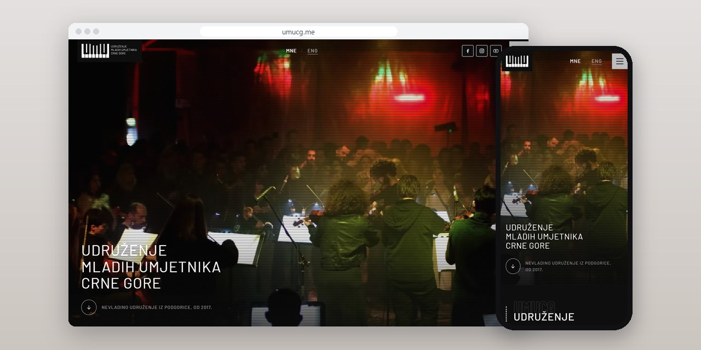
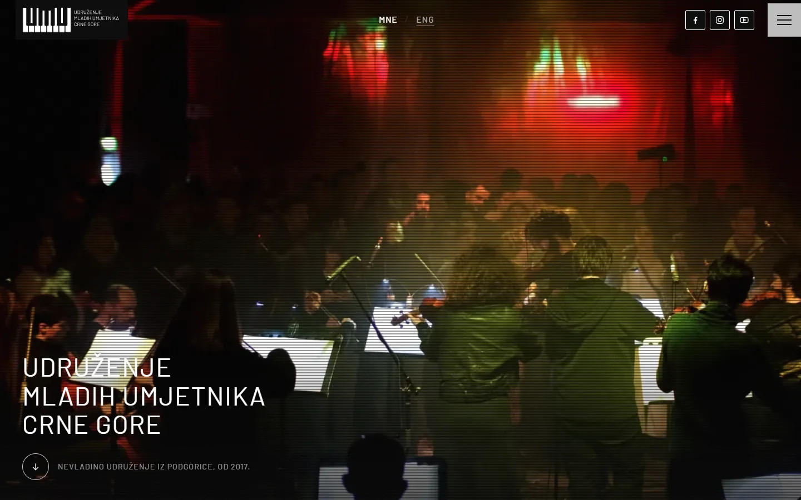
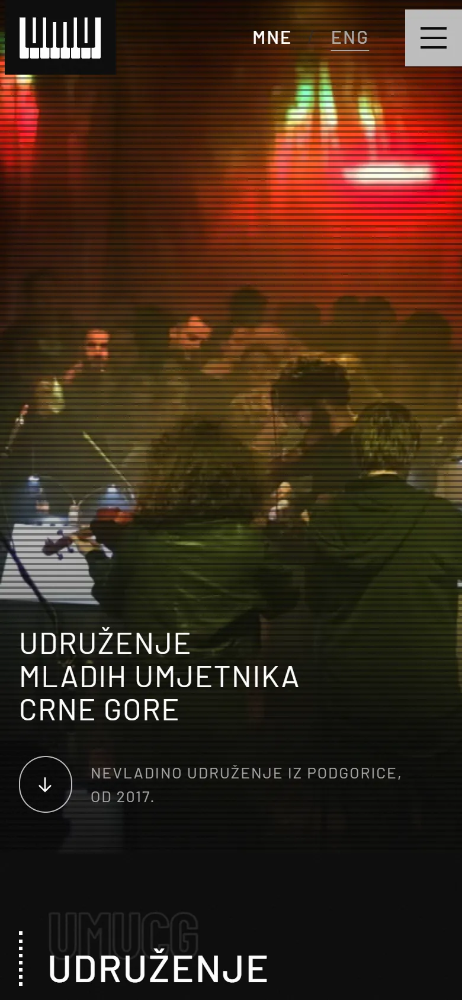
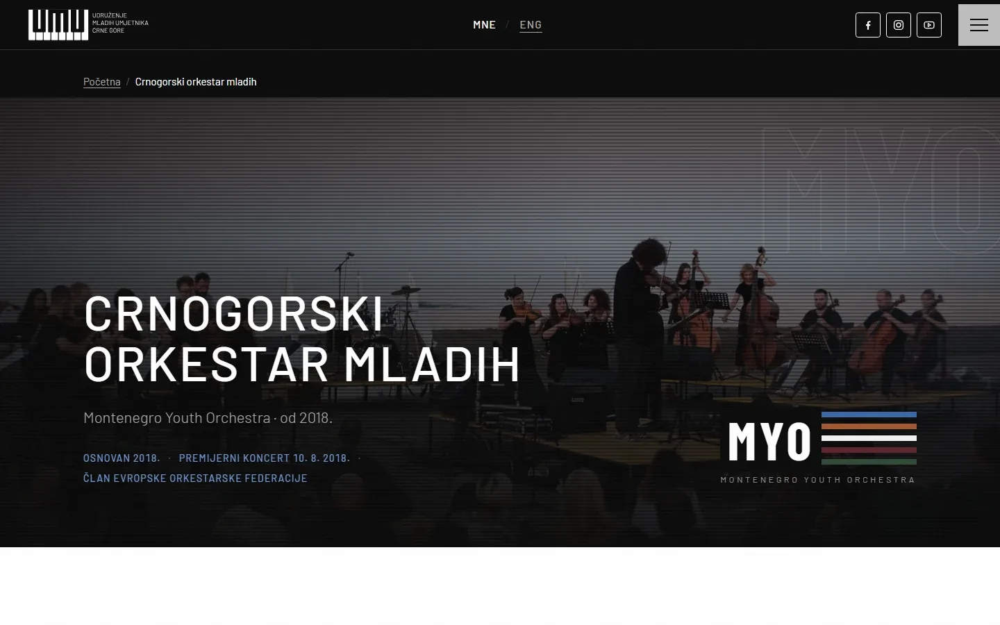
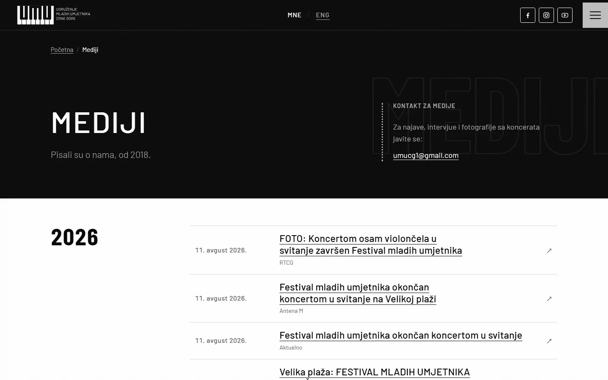

# UMUCG

Dvojezični sajt udruženja mladih umetnika iz Podgorice i njegovog orkestra mladih, sa hronikom koncerata od 2018. i 112 članaka iz medija.

**[umucg.me](https://umucg.me/)** · [Studija slučaja](https://svilenkovic.rs/radovi/umucg) · [English](README.md)

> [!NOTE]
> Klijentski projekat. Izvorni kod pripada klijentu i čuva se u privatnom repozitorijumu. Ova stranica opisuje šta sam uradio i kako.

<table>
  <tr><td><b>Klijent</b></td><td>Udruženje mladih umjetnika Crne Gore</td></tr>
  <tr><td><b>Delatnost</b></td><td>Savremena umetnost i Crnogorski orkestar mladih</td></tr>
  <tr><td><b>Lokacija</b></td><td>Podgorica, Crna Gora</td></tr>
  <tr><td><b>Vrsta</b></td><td>Dvojezični sajt udruženja</td></tr>
  <tr><td><b>Moj deo posla</b></td><td>Redizajn, izrada, selidba, SEO i hosting</td></tr>
  <tr><td><b>Tehnologije</b></td><td>Astro 7, TypeScript, AVIF, WebP, JSON-LD</td></tr>
</table>

## O projektu

Udruženje mladih umjetnika Crne Gore je nevladino udruženje iz Podgorice koje radi od 2017. godine. Osnovalo je Crnogorski orkestar mladih 2018, a sa kompanijom Montenegro Music Production i Festival mladih umjetnika 2024. Stari sajt bio je na WordPress-u. Novi daje udruženju, orkestru, festivalu, projektima i medijima svako svoje mesto, na crnogorskom jeziku, sa engleskom verzijom pod /en/.

Na strani orkestra su godina osnivanja, premijerni koncert 10. avgusta 2018, članstvo u Evropskoj orkestarskoj federaciji, zemlje u kojima je orkestar nastupao i izbor snimaka sa koncerata. Ispod je hronika od 25 događaja od 2018. do 2026, po godinama. Veći koncerti imaju svoju stranu sa programom, izvođačima i mestom, a strukturisani podaci ih opisuju kao muzičke događaje sa delima koja su izvedena. Tekstovi su preneti sa starog sajta i sređeni sa udruženjem u dva kruga izmena.

## Šta sam uradio

- 40 strana, 20 na crnogorskom i 20 na engleskom, sa starim adresama preusmerenim na nove
- Hronika od 25 događaja od 2018, sa posebnim stranama za veće koncerte
- Strane za pet projekata, među njima dva iz programa Interreg IPA i anketa o mladima i kulturi čiji su rezultati brojkama na naslovnoj
- Strana Mediji sa 112 članaka od 2018, po godinama, sa nazivom medija i vezom na originalni tekst
- Godišnji finansijski izveštaji od 2017. do 2025. kao PDF dokumenti sa veličinom fajla
- Uvodni snimak orkestra koji se na računaru pomera sa skrolom, a na telefonu ili uz smanjen pokret ostaje mirna slika

## Merenja

| | Performanse | Pristupačnost | Dobre prakse | SEO |
| :-- | :-: | :-: | :-: | :-: |
| Telefon | 100 | 100 | 100 | 100 |
| Desktop | 100 | 100 | 100 | 100 |

PageSpeed Insights, laboratorijsko merenje živog sajta, novembar 2026. Sigurnosna zaglavlja: 6 od 6. axe provera pristupačnosti: bez prekršaja. Strukturisani podaci: `MusicGroup`, `NGO`.

## Snimci ekrana

<table>
  <tr>
    <td width="68%" valign="top"></td>
    <td width="32%" valign="top"></td>
  </tr>
</table>

Crnogorski orkestar mladih: osnovan 2018, premijerni koncert 10. 8. 2018. i članstvo u Evropskoj orkestarskoj federaciji

Mediji: članci od 2018, sa nazivom medija i vezom na originalni tekst

---

Izrada: [D. Svilenković](https://svilenkovic.rs).
